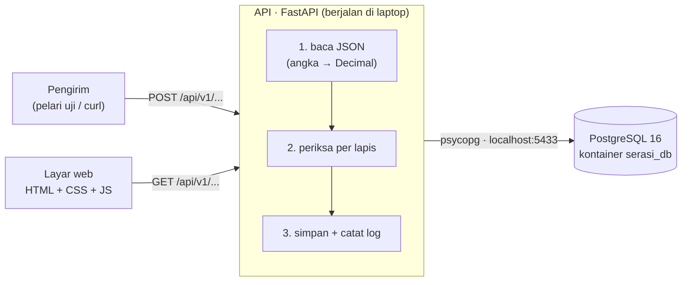
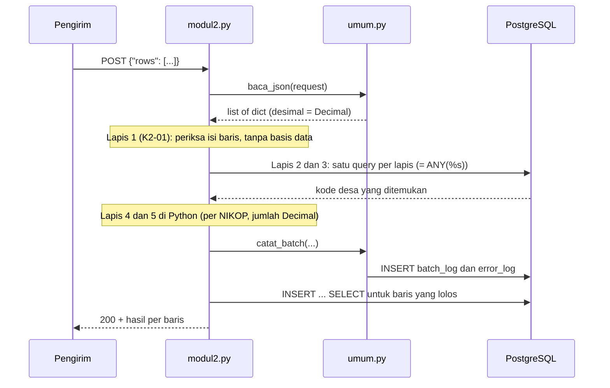
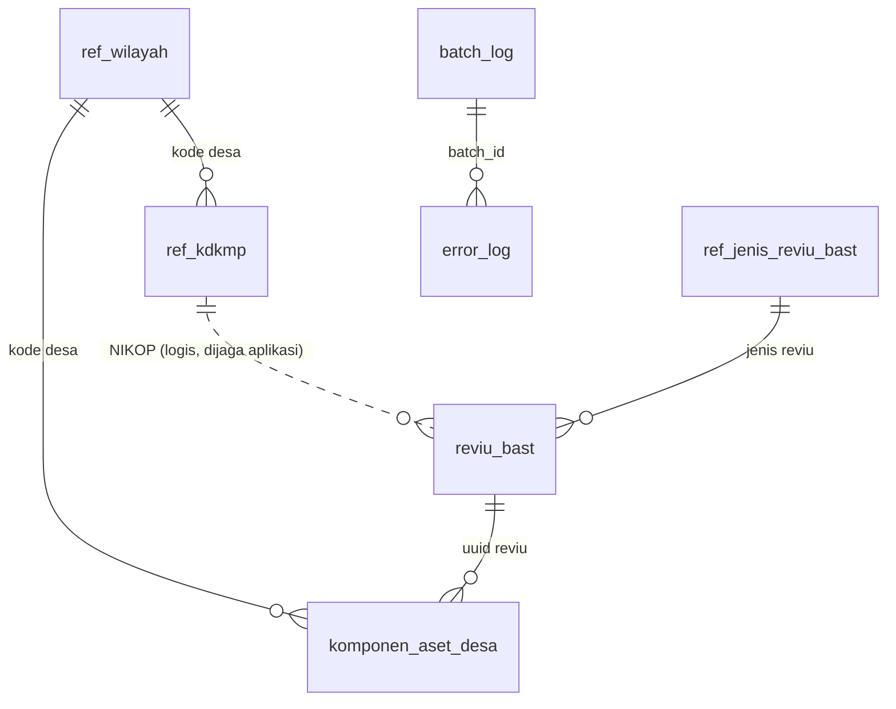

# Purwarupa ICA Serasi

Purwarupa terbatas untuk **Modul 1 sampai 4** ICA Serasi: sebuah API, basis data PostgreSQL, dan satu set layar web sederhana. Pengirim data (pengganti SIMKOPDES) mengirim data ke API, API memeriksa setiap baris lewat beberapa lapis validasi, baris yang lolos disimpan, baris yang gagal dicatat beserta alasannya, lalu layar web menampilkan isi basis data.

| Modul | Tabel | Aturan utama |
|---|---|---|
| 1. Referensi Wilayah | `ref_wilayah` | Satu baris cacat berarti seluruh kiriman ditolak (`W1-01`). Data lama dengan kode desa sama ditimpa (upsert). |
| 2. Referensi KDKMP | `ref_kdkmp` | Lima lapis validasi (`K2-01` sampai `K2-05`), *partial acceptance*. |
| 3. Reviu BAST | `reviu_bast` | Tujuh pemeriksaan berurutan (`R3-01` sampai `R3-07`), *partial acceptance*, *append-only*. |
| 4. Komponen Aset Desa | `komponen_aset_desa` | Terbentuk otomatis saat reviu BAST tersimpan: `ROUND(porsi × nilai / 100, 2)`. |

> **Catatan.** Purwarupa ini adalah **objek uji** untuk menelaah dokumen kebutuhan (UR dan DPPL), bukan sistem ICA Serasi yang sudah jadi. Semua data adalah data dummy, tidak ada autentikasi, dan teknologinya berbeda dari sistem produksi. Modul 5 (`basis_permohonan_bank`) hanya ada di skema dan tidak dibangun.

## Tech Stack

| Lapisan | Teknologi | Keterangan |
|---|---|---|
| Bahasa | Python 3 | Server API dan semua skrip uji |
| Kerangka API | FastAPI 0.162.2 + Uvicorn 0.54.0 | Endpoint `/api/v1/...`, dokumentasi otomatis di `/docs` |
| Akses basis data | psycopg 3.3.8 (binary) | SQL ditulis langsung, **tanpa ORM** |
| Konfigurasi | python-dotenv 1.2.3 | Membaca koneksi basis data dari `.env` |
| Basis data | PostgreSQL 16 (Docker) | `NUMERIC` untuk uang dan porsi, bukan `float` |
| Kontainer | Docker Desktop + Docker Compose | Hanya basis data yang berjalan di Docker |
| Antarmuka | HTML, CSS, JavaScript biasa | Tanpa Node.js, tanpa *build*, disajikan FastAPI di `/ui/` |
| Pengujian | pytest 9.2.0, pytest-cov | Uji white box, cakupan kode, dan uji mutasi |

## Panduan Penyusunan

### Prasyarat

- Docker Desktop menyala (status *Engine running*)
- Python 3 terpasang
- Git

### 1. Siapkan konfigurasi

Salin `.env.example` menjadi `.env`, lalu isi `DB_PASSWORD` dengan kata sandi lokal apa saja. Berkas `.env` tidak ikut di-commit.

```bash
cp .env.example .env
```

| Variabel | Bawaan | Fungsi |
|---|---|---|
| `DB_USER` | `serasi` | Pengguna PostgreSQL |
| `DB_PASSWORD` | – | Kata sandi lokal |
| `DB_NAME` | `serasi_prototype` | Nama basis data |
| `DB_HOST` | `localhost` | Host basis data |
| `DB_PORT` | `5433` | Port di laptop (diteruskan ke 5432 di kontainer) |

### 2. Nyalakan basis data

```bash
docker compose up -d
```

Kontainer `serasi_db` dibuat dan skema dari `db/001_schema.sql` dijalankan otomatis, **hanya saat basis data pertama kali dibuat**. Bila skema berubah, hapus volume lalu nyalakan ulang dengan `docker compose down -v` dan `docker compose up -d` (semua data akan hilang).

### 3. Jalankan aplikasi (Terminal 1)

macOS / Linux:

```bash
cd app
python3 -m venv .venv
source .venv/bin/activate
pip install -r requirements-dev.txt
uvicorn main:app --reload --port 8000
```

Windows (PowerShell):

```powershell
cd app
python -m venv .venv
.venv\Scripts\Activate.ps1
pip install -r requirements-dev.txt
uvicorn main:app --reload --port 8000
```

Pembuatan venv dan `pip install` cukup dilakukan sekali. `requirements-dev.txt` sudah mencakup `requirements.txt`.

### 4. Periksa dan buka aplikasi

| Alamat | Isi |
|---|---|
| http://127.0.0.1:8000/healthz | Harus menjawab `{"status": "ok"}` |
| http://127.0.0.1:8000/ui/ | Layar web (garis miring di akhir wajib ada) |
| http://127.0.0.1:8000/docs | Dokumentasi API otomatis |

### 5. Jalankan pengujian (Terminal 2)

**Black box: pelari skenario** (29 langkah, S01 sampai S28 dan T01). Selalu mulai dari basis data kosong dengan `--reset`.

```bash
cd uji
python jalankan_kasus.py --url http://127.0.0.1:8000 --reset
```

Keluaran yang benar diakhiri `Ringkasan: 29 lolos, 0 gagal`. Pakai `--sampai S05` untuk berhenti di satu langkah atau `--hanya S12` untuk menjalankan satu langkah. Rincian ada di [uji/README.md](uji/README.md).

**White box: pytest** (butuh basis data menyala, dijalankan dari folder `app/` dengan venv aktif).

```bash
pytest                          # seluruh uji white box
python tests/ringkas_cakupan.py # cakupan per fungsi
python tests/uji_mutasi.py      # uji mutasi
```

### 6. Melihat isi basis data langsung

```bash
docker exec -it serasi_db psql -U serasi -d serasi_prototype -c "SELECT dataset, total_baris, baris_diterima, baris_ditolak FROM batch_log ORDER BY diterima_pada DESC LIMIT 5;"
```

### Alur kerja Git

- Satu cabang per pekerjaan (misalnya `modul-2`, `ui-riwayat`), digabung ke `main` lewat Pull Request. Kode di `main` harus selalu bisa dijalankan.
- Pesan commit berbahasa Indonesia dan diawali nama modul, misalnya `modul-2: tambah validasi duplikasi`.
- Jangan memakai `git push --force`. Bila push ditolak, tarik dan gabungkan perubahan dulu.
- `.env`, `.venv/`, dan `referensi/` tidak boleh di-commit (sudah ada di `.gitignore`).

## Architecture

### Gambaran umum



Hanya PostgreSQL yang berjalan di dalam Docker. Aplikasi Python berjalan langsung di laptop dan juga menyajikan folder `ui/` di alamat `/ui/`, sehingga perubahan kode langsung terlihat lewat `--reload` tanpa membangun ulang image.

### Struktur folder

```
prototype-ica-serasi/
├── docker-compose.yml      # kontainer PostgreSQL
├── .env.example            # contoh .env tanpa kata sandi asli
├── db/001_schema.sql       # skema semua tabel, dijalankan otomatis saat basis data pertama dibuat
├── docs/002_KONTRAK_API.md # kontrak API: endpoint, aturan validasi, keputusan desain D1–D10
├── app/                    # aplikasi server
│   ├── main.py             # titik masuk: mendaftarkan router dan folder ui
│   ├── db.py               # koneksi ke PostgreSQL (satu blok with = satu transaksi)
│   ├── umum.py             # fungsi bersama: baca JSON, jawaban, catat batch, halaman
│   ├── modul1.py … modul4.py
│   ├── turunan.py          # pembentukan komponen_aset_desa (dipanggil modul3)
│   ├── riwayat.py  opsi.py  koperasi.py   # endpoint baca untuk layar
│   ├── internal.py         # reset data, khusus pengujian
│   └── tests/              # uji white box dan uji mutasi (pytest)
├── ui/                     # index.html, app.css, app.js
└── uji/                    # pelari skenario, server tiruan, data_dummy/
```

### Endpoint

Semua endpoint berada di bawah `/api/v1`. Daftar (GET) menjawab dengan bentuk `{"page", "per_page", "total", "items": [...]}`; `per_page` bawaan 20, maksimum 100.

| Endpoint | Fungsi | Berkas |
|---|---|---|
| `POST /ref-wilayah/bulk` | Terima data wilayah (all-or-nothing) | `modul1.py` |
| `POST /ref-kdkmp` | Terima data koperasi, lima lapis validasi | `modul2.py` |
| `POST /reviu-bast` | Terima reviu BAST, tujuh pemeriksaan, memicu Modul 4 | `modul3.py` |
| `GET /ref-wilayah`, `/{kode}` | Daftar dan detail wilayah | `modul1.py` |
| `GET /ref-kdkmp`, `/{kode}` | Daftar dan detail koperasi per desa | `modul2.py` |
| `GET /reviu-bast`, `/{uuid}` | Daftar dan detail reviu | `modul3.py` |
| `GET /komponen-aset-desa` | Komponen aset per desa | `modul4.py` |
| `GET /koperasi`, `/{nikop}` | Koperasi digabung per NIKOP | `koperasi.py` |
| `GET /batches`, `/batches/{batch_id}/errors` | Riwayat pengiriman dan error log | `riwayat.py` |
| `GET /opsi/provinsi`, `/opsi/kabkota` | Isi dropdown filter | `opsi.py` |
| `POST /internal/reset` | Kosongkan semua tabel data (pengujian) | `internal.py` |
| `GET /healthz` (tanpa `/api/v1`) | Cek aplikasi dan basis data hidup | `main.py` |

Kode status: `200` batch diproses walau sebagian baris ditolak, `400` isi bukan JSON, `422` struktur salah (seluruh batch tidak diproses), `404` data tidak ditemukan, `405` UPDATE/DELETE pada `reviu_bast`. Kontrak lengkap ada di [docs/002_KONTRAK_API.md](docs/002_KONTRAK_API.md).

### Alur satu permintaan

Contoh `POST /api/v1/ref-kdkmp`. Semua langkah ke PostgreSQL terjadi dalam **satu transaksi**: bila ada galat di tengah, tidak ada data setengah jadi yang tertinggal.



### Basis data



- **`ref_kdkmp`** berkunci utama kode desa, sehingga satu koperasi bersama bisa muncul di beberapa baris. Akibatnya NIKOP di `reviu_bast` tidak bisa dijadikan FK fisik dan keberadaannya diperiksa di kode (`R3-02`).
- **`batch_log` dan `error_log`** ditambahkan khusus untuk purwarupa (tidak ada di DPPL). Satu pengiriman membuat satu baris `batch_log`; setiap baris yang ditolak membuat satu baris `error_log` berisi kode, field, pesan, dan salinan isi barisnya (JSONB).
- **Uang dan porsi** disimpan sebagai `NUMERIC(15,2)` dan `NUMERIC(9,6)`, dibaca sebagai `Decimal` di Python, dan dikirim sebagai teks desimal (`"1000000001.00"`) supaya tidak ada pembulatan biner.
- **Dua lapis pertahanan:** aturan dijaga di kode Python (pesan galat jelas per baris) dan di basis data lewat `CHECK` dan `UNIQUE`.
- Rancangan tabel mengikuti DPPL SIKD Serasi V5.04 (Bab 4.2) dan User Requirement V5.04 apa adanya, termasuk kolom yang ditulis ulang di beberapa tabel, supaya rancangan DPPL itulah yang diuji.
